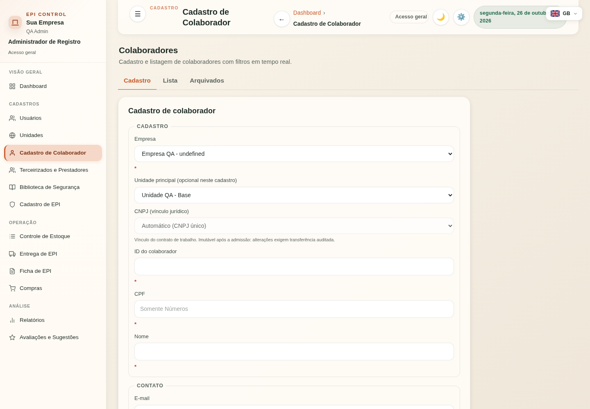
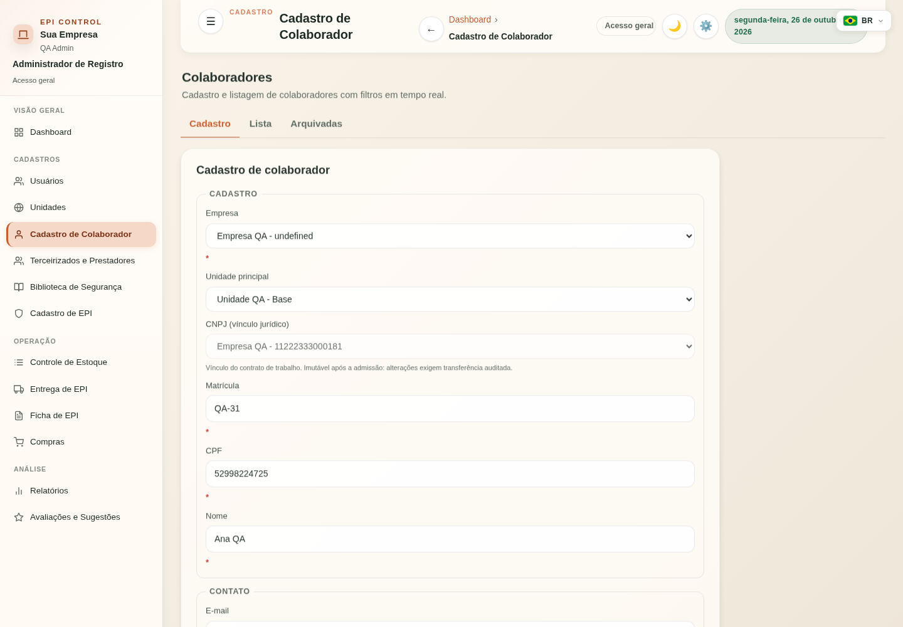

# FIX-COLAB-TERC-V1 — evidências técnicas

Correção dos achados funcionais 1, 4 e 5 da [UBX-V4 §12.5](UBX_APPJS_AUDITORIA.md#125-achados-registrados-nenhum-corrigido--mudar-é-decisão-de-negócio).

## Bases reproduzidas

- Corporate: `aa35a81d2541c4d2e7cd358eb058436558d10ef8`.
- SaaS: `4927b145aecd30ebc3f763479579a18cd776e4c5`.

Chromium real, HTML e scripts completos de cada projeto, dados sintéticos e interceptação de todas as APIs. Nenhum servidor de aplicação ou banco é aberto; requisições externas são bloqueadas. Os três defeitos foram reproduzidos antes de editar o código nos dois projetos. A reprodução da edição inclui entrada programática a partir de outra view; a edição na mesma view é controle positivo, não é descrita como universalmente quebrada.

## Causas e correções

| Fluxo | Antes | Depois |
|---|---|---|
| Arquivar/reativar colaborador terceirizado na Unidade | POST persiste; `loadEmployees()` inexistente gera alerta e deixa estado/lista antigos | `loadBootstrap({preserveView:true})` atualiza o estado autorizado e a UI re-renderiza; falhas HTTP não simulam sucesso |
| Incluir/editar empresa terceirizada | `<input name="id">` encobre `HTMLFormElement.id`; comparação `event.target.id` não identifica o formulário e pula o carregador opt-in | Identidade DOM lida por `getAttribute('id')`; carregador opt-in executado depois do sucesso |
| Arquivar/restaurar empresa | Arquivamento global só atualiza bootstrap e arquivados; bootstrap não contém empresas terceirizadas | Recarrega também empresas terceirizadas; vínculo local mantém seu carregador existente |
| Editar Colaborador | Campos preenchidos antes de `showView`; reset F5-B de entrada apaga os valores | Navegação sem refresh parcial antes da hidratação; foco em Cadastro; filtros preservados na mesma view |
| Identidade de edição | Reset nativo mantém o valor de input hidden; `form.id` encoberto também pula reset de modo/CNPJ | Limpeza explícita do ID nos três formulários do escopo; atualização armada somente ao terminar a hidratação |
| Valores existentes fora das opções de cadastro | Unidade arquivada, escala antiga ou CNPJ inativo podem virar seleção vazia | Conserva opção do registro já autorizado, com rótulo via `textContent`; CNPJ continua desabilitado na edição e ausente do PUT |

`preserveView` é opt-in dos fluxos corrigidos. O bootstrap inicial e as demais chamadas continuam com sua navegação anterior; `showView` revalida permissões. A correção de identidade no handler compartilhado também permite os ramos existentes de EPI/CNPJ reconhecerem seus formulários; os testes existentes continuam sendo executados.

## Arquitetura e segurança

- UI permanece nos módulos UBX-V4; HTTP pelo cliente e integrações canônicos.
- Nenhuma declaração/endereço novo no monólito; baseline UBX sem alteração.
- Backend, regras de autorização, RLS, migrações e contratos HTTP sem alterações.
- Editor exige `employees:update`, acesso à view e registro filtrado por empresa; master_admin mantém a semântica existente de escopo, sujeito às permissões recebidas.
- Escopo de Unidade permanece determinado pelo backend. Testes funcionais interceptados não substituem prova de autorização do backend; a suíte Python existente cobre essas regras.
- Nenhuma chave/texto de produto adicionada. Os cinco catálogos existentes são carregados com o mesmo envelope da API real e o idioma ativo é conferido durante cada cenário.
- Paridade byte a byte dos arquivos funcionais, testes e workflow; `index.html` é gerado separadamente em cada projeto, preservando sua identidade.

## Regressões e reprodução

```sh
node static/js/test/run-tests.js
node static/js/test/app-js-boundary.js
python3 scripts/build_index.py check
pip install playwright==1.58.0
python -m playwright install chromium
python scripts/browser/fix_colab_terc.py --output /tmp/fix-colab-terc
# Ou: CHROMIUM_EXECUTABLE=/usr/bin/chromium python scripts/browser/fix_colab_terc.py
pytest tests/ -q
```

O workflow `Colaboradores and outsourced browser regression` executa Chromium nos cinco idiomas e anexa screenshots e requisições sintéticas. A suíte Node inclui sete regressões novas do handler real, incluindo colisão de `form.id`, limpeza do hidden e refresh de arquivamento/restauração global. Somente as diferenças funcionais autorizadas são atualizadas nas tabelas históricas de caracterização.

[Evidências antes/depois](evidence/FIX_COLAB_TERC_V1/results.json) registram os dois produtos, requisições e falhas reproduzidas. [Provas independentes](evidence/FIX_COLAB_TERC_V1/independent-results.json) registram seis cenários por produto: falha de PUT preserva rascunho/ID, revalidação de acesso em refresh, escopo master_admin, rótulo malicioso inerte, PUT seguido de novo POST e filtros preservados.

## Auditoria independente

Subagente separado, somente leitura, autorizado pelo responsável. Revisou os dois diffs, arquitetura, isolamento e contratos; executou suas próprias provas Chromium (12/12), suíte JS (587) e guarda UBX (798 declarações, 112 endpoints, zero ciclos). Veredito: **aprovado, sem P0/P1/P2 pendentes atribuíveis à mudança**, condicionado aos resultados finais de CI/HEADs.

## Complemento (Claude) — arquivamento sem perder a tela

Revisão do que já estava integrado (Corporate #1062, SaaS #436), sem reimplementar: os três defeitos originais seguem corrigidos. Restava uma lacuna do mesmo defeito no fluxo genérico de arquivamento (`ARCHIVAL_ENTITIES`), reproduzida em Chromium nas bases `bc94d951` (Corporate) e `38d9446` (SaaS):

| Fluxo | Antes | Depois |
|---|---|---|
| Arquivar/desarquivar colaborador terceirizado (cadastro global) | Listas atualizavam, mas `loadBootstrap()` sem `preserveView` levava o usuário ao Dashboard | Permanece em Terceirizados e Prestadores com as listas ativas e arquivadas atualizadas |
| Arquivar/desarquivar colaborador CLT | Mesma navegação para o Dashboard | Permanece em Colaboradores |
| Excluir definitivamente empresa ou colaborador terceirizado | `purgeArchivedRecord` recarregava sem `preserveView` → Dashboard | Permanece na aba de arquivados, já sem o registro |

Correção: flag declarativa `preserveView: true` nas entradas `employee`, `outsourcedCompany` e `outsourcedEmployee` de `ARCHIVAL_ENTITIES`, lida por `archiveEntityRecord`, `restoreArchivedRecord` e `purgeArchivedRecord` (substitui o teste fixo `kind === 'outsourcedCompany'`). Nenhuma função ou endereço novo no monólito (guarda: 798 declarações, 112 endpoints). EPI e Unidades mantêm a navegação anterior — fora do escopo de Colaboradores/Terceirizados; o mesmo padrão existe lá e fica registrado para decisão.

Regressões:

- `static/js/test/fix-colab-terc-runtime.js`: 12 casos sobre a configuração **real** de `ARCHIVAL_ENTITIES` (arquivar/desarquivar/excluir × 4 kinds); contra a base, 7 falham (exatamente as lacunas).
- `scripts/browser/fix_colab_terc.py`: cenários `employee_archival`, `purge` e `editor_click` (clique real em Editar na Lista, troca de aba, PUT sem campos vazios). 8 cenários × 5 idiomas = 40/40; contra a base, `employee_archival` e `purge` falham em todos os idiomas.
- Defeito 3 conferido por clique real: na base anterior à FIX (`aa35a81d`) salvar a edição levava ao Dashboard; na `main` atual passa.

## Limites operacionais

Sem merge, deploy, alteração de dados reais, bancos compartilhados ou proteção de branches. PostgreSQL dos workflows de CI é descartável no runner. Rollback: reverter o commit da correção; nenhuma migração/dado exige reversão. HEADs finais e links/resultados de CI constam dos PRs draft e da entrega.

## Resultados locais

- Antes: quatro cenários falham em cada base (vínculo de colaborador, inclusão/alteração de empresa, restauração corporativa e edição após entrada na view).
- Depois: **25/25 cenários Chromium por projeto**, com cinco idiomas efetivamente ativos; **50/50** no total.
- **587 testes JS por projeto**, guarda UBX e index sincronizado; ESLint dos módulos/regressões alterados passa.
- Python SaaS: **4.392 passed, 44 skipped**. Corporate: **4.450 passed, 48 skipped**, com uma oscilação do teste preexistente de medição temporal de recuperação de senha na execução concorrente; repetição isolada passou (1/1); CI registrada na entrega. Ruby e odfpy foram disponibilizados somente no ambiente de teste, sem mudar dependências de produto.



