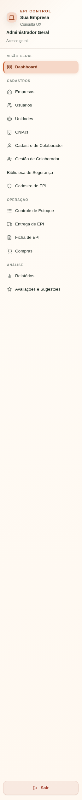
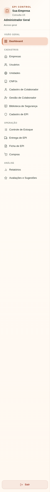
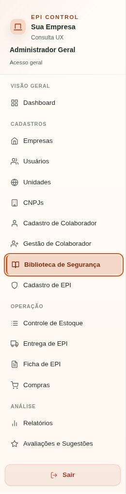
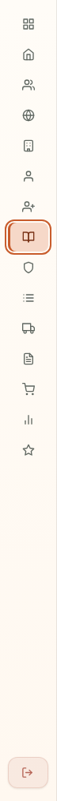
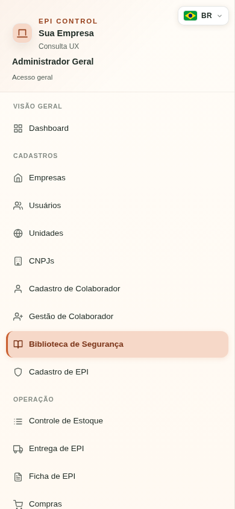

# UI-FIX-BIBLIOTECA-ICON-V1

O menu Biblioteca de Segurança era o único item desse grupo sem SVG no fragmento `static/views/_sidebar.html`, nos dois produtos. Os ícones existentes são SVG inline no padrão Feather/Lucide, sem carregador externo. A correção adiciona o desenho `book-open` nesse mesmo mecanismo: 16×16, `currentColor`, traço 2, extremidades e junções arredondadas, decorativo (`aria-hidden`). O botão mantém seu nome acessível e destino.

Arquivos funcionais: `static/views/_sidebar.html` e `static/index.html` reconstruído com `scripts/build_index.py build`. Nenhuma mudança em app.js, CSS, backend, RBAC, rota ou biblioteca de documentos. Base com UBX-V2 já integrada; branches Claude preservadas.

## Validação

- 517 testes JavaScript aprovados por produto.
- 66 testes Python de arquitetura/navegação aprovados por produto.
- Guarda UBX: 936 declarações, 121 endpoints, 69 endpoints na UI e zero ciclos, sem crescimento.
- Build/check do HTML e `git diff --check` aprovados.
- Playwright/Chromium real, HTTP/JWT e PostgreSQL local isolado: ícone expandido, recolhido, hover, ativo, navegação por Enter e menu em 390×844. Tamanho/traço/cor/opacidade comparados com Cadastro de EPI via estilos computados. General Admin navega para Biblioteca; perfil user continua sem acesso ao menu. Sem erros JavaScript.
- Paridade byte a byte do fragmento de sidebar entre Corporate e SaaS; index preserva diferenças de produto.

## Evidência

O antes usa o HTML original da base Git servido por interceptação Playwright, com o mesmo CSS e dados sintéticos. O depois usa o HTML real reconstruído, sem interceptação. As capturas abaixo não usam dados reais.

Veredito local: aprovado para revisão humana. CI e HEAD final registrados na descrição do PR. Merge e deploy dependem de decisão humana e não foram executados.
