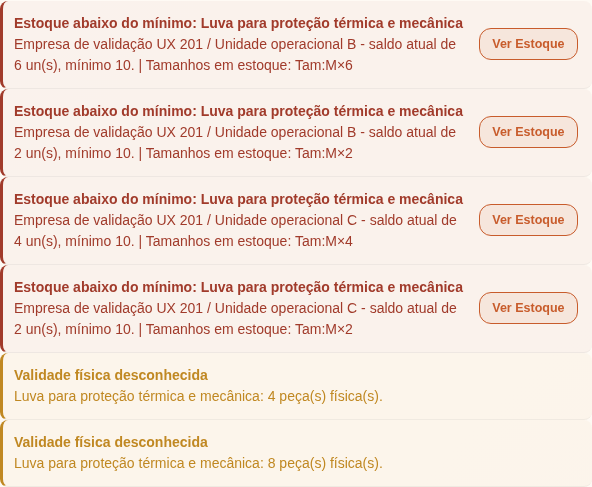
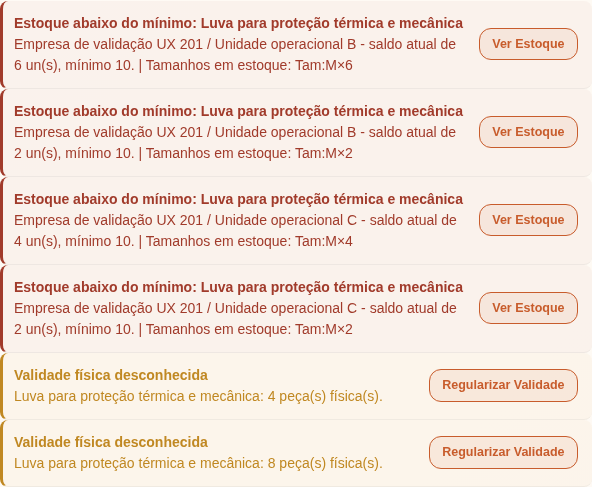
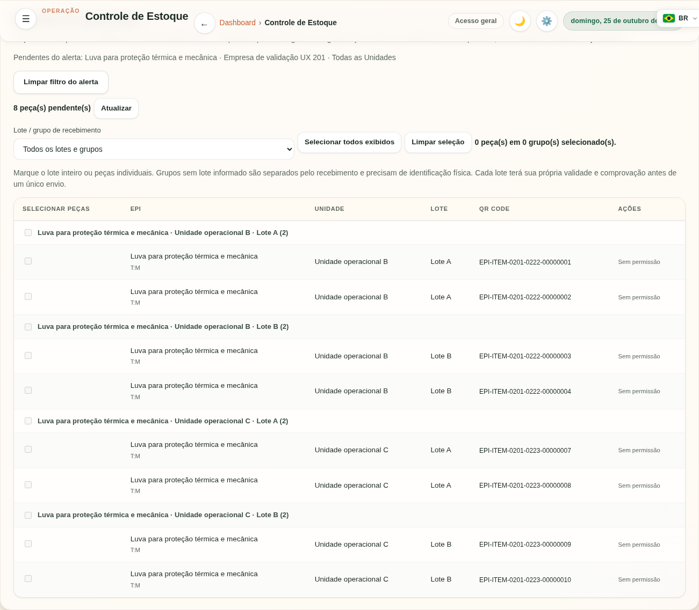
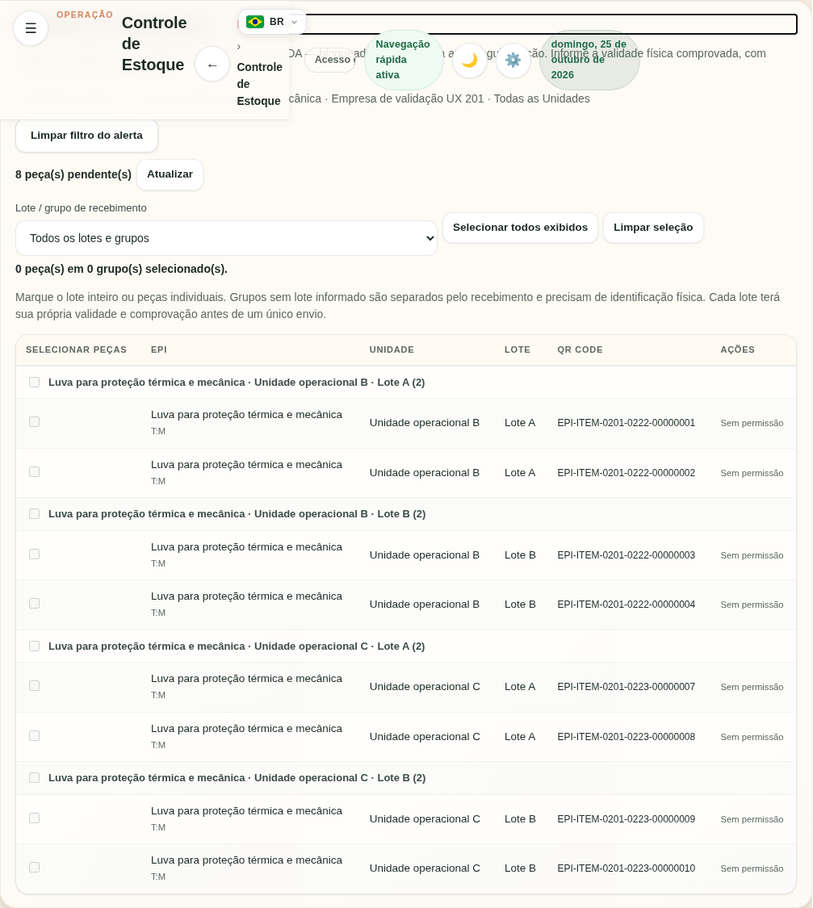
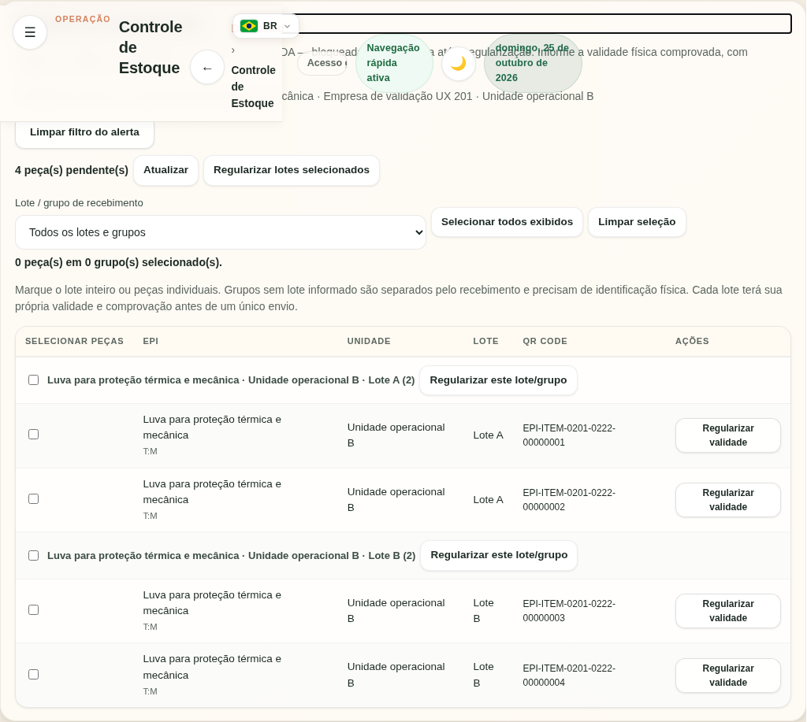

# UX-ALERT-VALIDADE-V1

Adiciona “Regularizar Validade” ao alerta “Validade física desconhecida”, reutilizando `.alert-action`, sem mudanças de CSS ou nos demais alertas. A identificação acessível inclui o nome do EPI e o foco segue para o título do painel existente após a navegação por teclado.

## Destino real e escopo

Dashboard → Controle de Estoque (`data-view="estoque"`) → Validade e Bloqueios (`data-vtab="validade"`) → Pendentes de regularização (`#pending-reg-card`). Reutiliza GET `/api/stock/pending-regularization`; nenhum endpoint novo. O backend autoriza leitura e resolve empresa/unidade. O módulo filtra a resposta autorizada pelo **ID exato** do EPI e conserva todos os lotes/peças correspondentes, inclusive EPIs diferentes com nomes iguais.

O recorte fica explícito no painel e pode ser limpo. Administrador Local (`admin`) e Gestor (`user`) conservam sua unidade operacional. Alerta agregado da empresa sem unidade consulta todas as unidades no painel de pendências, sem herdar silenciosamente a primeira unidade do formulário de movimentação. O restante do estoque mantém seus seletores normais. Troca de escopo, saída da view ou troca de usuário limpa o recorte.

As ações existentes de regularização individual e em massa continuam disponíveis só com `stock:regularize_validity`; perfis de leitura somente consultam. Nenhum clique de navegação altera dados, seleciona peças ou submete regularização. RBAC, isolamento, evidência de lote, bloqueios e auditoria continuam no backend existente.

## Arquitetura e integração

Alertas já extraídos em `static/js/views/dashboard.js`. O novo módulo `modules/stock/ui/pending-validity-navigation.js` concentra a intenção de navegação e recebe portas explícitas via `configure`. O app.js somente conecta essas portas e aplica o contexto/filtro no loader que já existia. Não ganha declarações ou endpoints. A guarda UBX-V2 passou com 936 declarações, 121 endpoints no app, 69 na UI e zero ciclos. A guarda não foi alterada.

A main avançou com UBX-V2 durante o trabalho. Integração realizada nas branches desta tarefa; o único conflito era o index gerado, resolvido por reconstrução a partir dos fragmentos. Nenhuma branch Claude foi modificada.

O PR separado UI-FIX-BIBLIOTECA-ICON-V1 toca `_sidebar.html`; este toca `_scripts.html` e `estoque.html`. São funcionalmente compatíveis. Na integração dos dois, reconstruir `static/index.html` com `python scripts/build_index.py build` a partir dos fragmentos combinados; não substituir o index de um PR pelo outro.

## Validação

- 523 testes JavaScript por produto, incluindo seis cenários novos de navegação, escopo, autorização e ciclo de vida do filtro (sete execuções contando ambos perfis operacionais).
- 156 testes Python selecionados por produto: arquitetura UBX, paridade F4/F5B, regularização em massa e evidência de lote via HTTP/JWT/PostgreSQL real. Incluem negativas de autorização e isolamento já implementadas.
- Build/check do index, `git diff --check` e lint dos arquivos novos aprovados.
- Playwright/Chromium com backend HTTP/JWT e PostgreSQL local isolado: seis combinações por produto (general_admin/admin/user × desktop 1617×1000/mobile 390×844; SPA desabilitada/habilitada). General Admin consulta oito peças em quatro lotes de duas unidades; admin/user consultam quatro peças em dois lotes da unidade operacional. EPI de mesmo nome e outra empresa excluídos. Unidade inicial vazia não oculta pendências agregadas. Lote com validade conhecida excluído.
- Estilos computados comparados com Ver Estoque; Enter, foco, aba real, limpeza do filtro e visibilidade de ações por perfil aprovados. Sem erros JavaScript e sem requisições de escrita após o clique. Snapshots completos de peças, lotes, eventos, movimentações e saldos idênticos antes/depois de cada navegação.
- Auditoria independente executa o módulo e o loader reais com respostas fora de ordem e tenta atravessar escopos; relatório final e hashes registrados no PR após congelamento.

## Arquivos funcionais e de teste

- `static/app.js`
- `static/i18n/en-GB.json`
- `static/i18n/es-ES.json`
- `static/i18n/fr-FR.json`
- `static/i18n/nb-NO.json`
- `static/i18n/pt-BR.json`
- `static/index.html`
- `static/js/test/run-tests.js`
- `static/js/views/dashboard.js`
- `static/views/_scripts.html`
- `static/views/estoque.html`
- `tests/test_343_f4_portal_cpf_sem_cache.py`
- `tests/test_343_f5b_navegacao_estado_inicial.py`
- `static/js/modules/stock/ui/pending-validity-navigation.js`
- `static/js/test/alert-validity-navigation-runtime.js`

## Evidência visual

O antes serve o dashboard.js original da base Git por interceptação Playwright; os demais recursos e dados sintéticos são os mesmos. O depois usa o código real atual, sem interceptação.

Resultado detalhado de navegador: [JSON](evidence/UX-ALERT-VALIDADE-V1/corporate-results.json). CI, auditoria final, HEADs e PRs ficam registrados na descrição do PR. Sem merge, deploy, force-push ou banco compartilhado. Pronto localmente para revisão humana; decisão de merge permanece humana.
